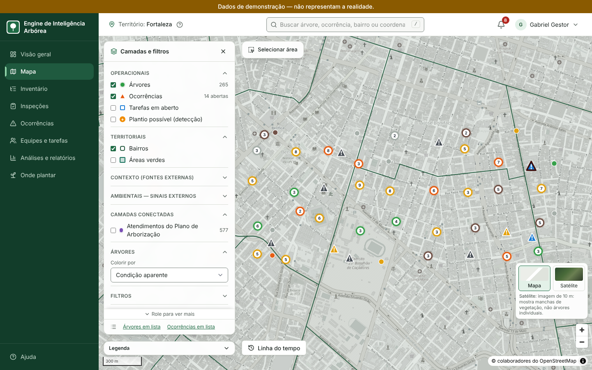

# iTree: Engine de Inteligência Arbórea

O iTree é uma base comum de dados das árvores de Fortaleza. Ele junta, num só
lugar, o inventário que vem de detecção automática (satélite e vídeo de rua), de
pesquisas existentes e de inspeção de campo, com a fonte, o método e a data de
cada dado. Foi pensado para pesquisa e ONG, com três objetivos:

- **Desigualdade verde:** onde há mais e menos árvore, cruzada com população, renda, IDH e a regra 3-30-300.
- **Inventário aberto e auditável:** cada valor mostra de onde veio, e cada mudança fica registrada.
- **Monitoramento de mudanças:** linha do tempo, comparação antes e depois e sinais de possível remoção.

Por enquanto **nada é público**: todo acesso é com login. Os dados de demonstração
são sempre sintéticos e declarados. O rumo atual está em
[decisões de 21/11/2026](docs/decisoes/2026-11-21-rumo-do-produto.md).



## O que já existe

O painel web (React, MapLibre) e a API (Django, GeoDjango) cobrem:

**Inventário e detecção**

- Árvores com origem, selo de confiança e proveniência de cada medida; contagem de
  todas e só das confirmadas.
- Recebimento de detecções automáticas por API (token de integração) ou pacote ZIP.
  A detecção entra no inventário e a revisão humana a confirma.
  [Contrato](docs/integracoes/deteccao-automatica.md) e [captura](docs/telas/55-deteccoes-lote.png).
- Importação de bases existentes (XLSX, Shapefile, GeoPackage, KML), com prévia,
  possíveis duplicidades e fusão.
- Catálogo de espécies com imagens e referências.
  [Galeria e linha do tempo da árvore](docs/telas/45-arvore-galeria.png).

**Mapa**

- Vector tiles com escopo territorial, agrupamento, busca global e mapa base de satélite
  configurável. [Satélite](docs/telas/47-mapa-satelite.png).
- Linha do tempo com a situação numa data passada e comparação com hoje.
  [Captura](docs/telas/53-mapa-linha-tempo.png).
- Camadas de contexto: áreas verdes, iluminação pública, edificações e uso do solo,
  macrozoneamento, ilha de calor, população e renda.
  [Iluminação](docs/telas/39-mapa-iluminacao.png), [renda por bairro](docs/telas/48-mapa-renda-por-bairro.png).

**Bairros, indicadores e planejamento**

- Ficha do bairro com indicadores, população, renda, IDH e a regra 3-30-300.
  [Ficha](docs/telas/58-ficha-bairro-3-30-300.png). O método está em [3-30-300](docs/indicadores/3-30-300.md).
- Análises com exportação (CSV, XLSX, GeoJSON, PDF) e registro de cada exportação.
  [Análises](docs/telas/50-analises-arvores-renda.png).
- "Onde plantar": cenário de priorização de bairros, com pesos ajustáveis.
  [Captura](docs/telas/51-planejamento.png).

**Operação**

- Inspeções (com API de sincronização para o aplicativo de campo), ocorrências,
  equipes e tarefas, alertas ambientais com triagem humana e notificações.
- Usuários, papéis, escopo territorial e auditoria. Todos os módulos ficam visíveis.
- Uso no celular e no tablet. [Capturas](docs/telas/README.md#celular-390-px).

O aplicativo móvel nativo de campo ainda não foi iniciado. Todas as telas estão
em [`docs/telas/`](docs/telas/README.md).

## Fontes de dados integradas

Dados públicos reais, sempre com órgão, licença ou termos e data de referência.
O índice completo (comando, periodicidade e estado de cada uma) está em
[`docs/integracoes/README.md`](docs/integracoes/README.md), e o detalhe de cada fonte
em [fontes públicas](docs/integracoes/fontes-publicas.md).

| Fonte                                     | Órgão                                    | Licença ou termos                                                                  | O que alimenta                                                                                                                              |
| ----------------------------------------- | ---------------------------------------- | ---------------------------------------------------------------------------------- | ------------------------------------------------------------------------------------------------------------------------------------------- |
| Fortaleza em Mapas e dados abertos (CKAN) | Ipplan, SEUMA, URBFOR, SEFIN, SEINF, SDE | Uso livre com citação (termos da API); `cc-by`, `cc-by-sa` ou `other-open` no CKAN | Regionais, bairros, áreas verdes, adoção de praças, macrozoneamento, IPTU, uso por lote, iluminação, IDH, manejo, doação de mudas e plantio |
| Censo 2022 e estimativas                  | IBGE                                     | Não declarada na fonte                                                             | Arborização do entorno, população, rendimento e estimativa anual                                                                            |
| Open Buildings v3                         | Google Research                          | CC BY 4.0                                                                          | Edificações (base do "300" da regra 3-30-300)                                                                                               |
| BDQueimadas e PRODES Caatinga             | INPE                                     | Não declarada; cita-se a fonte                                                     | Alertas de focos de calor e camada de supressão anual                                                                                       |
| UrbVerde                                  | IAU-USP                                  | Termos próprios: uso acadêmico e público, sem fins comerciais, com citação         | Ilha de calor de superfície                                                                                                                 |
| Wikidata, Wikipedia, Commons e GBIF       | Wikimedia, GBIF                          | Por registro, com autoria gravada                                                  | Referências e imagens das espécies                                                                                                          |
| Projeto de detecção automática            | Externo                                  | Contrato do iTree                                                                  | Árvores, pontos de plantio e sinais de remoção                                                                                              |

## Rodando

### Tudo em contêineres

```bash
docker compose -f infra/docker/compose.yml --profile completo up -d --build
docker compose -f infra/docker/compose.yml exec api /app/docker/entrypoint.sh \
  manage criar_administrador --email admin@itree.local --nome "Ana Administradora"
```

Painel em http://localhost:8088. Detalhes, variáveis de ambiente e checklist de
produção em [`infra/README.md`](infra/README.md).

### Localmente (desenvolvimento)

Requisitos: Docker, Node 24 + pnpm 10, Python 3.14 + [uv](https://docs.astral.sh/uv/)
e GDAL (`apt install gdal-bin libgdal-dev` ou `brew install gdal`).

1. Serviços de apoio (PostGIS, Redis, Keycloak com o realm `itree` e armazenamento S3):

   ```bash
   docker compose -f infra/docker/compose.yml up -d
   ```

2. Backend, em outro terminal:

   ```bash
   cd backend
   cp .env.example .env
   uv sync
   uv run python manage.py migrate
   uv run python manage.py criar_administrador --email admin@itree.local --nome "Ana Administradora"
   uv run python manage.py runserver
   ```

3. Web, em outro terminal:

   ```bash
   pnpm install
   cp apps/web/.env.example apps/web/.env
   pnpm --filter @itree/web dev
   ```

4. Abra http://localhost:5173 e entre com um dos usuários de desenvolvimento do
   Keycloak:

   | E-mail               | Senha    | Situação inicial                       |
   | -------------------- | -------- | -------------------------------------- |
   | `admin@itree.local`  | `admin`  | Administrador (criado no passo 2)      |
   | `gestor@itree.local` | `gestor` | Sem papéis até o administrador liberar |
   | `novo@itree.local`   | `novo`   | Sem papéis até o administrador liberar |

   Console do Keycloak: http://localhost:8080 (`admin` / `admin`). Essas senhas
   valem **só** para o ambiente local.

5. Para ter territórios, rode `importar_limites_fortaleza` (12 regionais e 121 bairros
   oficiais) ou importe os seus com `importar_territorios`. Os outros importadores
   estão no [índice de integrações](docs/integracoes/README.md). Fotos, tarefas em
   segundo plano e variáveis de ambiente estão em [desenvolvimento](docs/desenvolvimento.md).

Para ver o painel com dados sintéticos, use `scripts/telas/gerar.sh`
([como](docs/desenvolvimento.md#capturas-das-telas)). Ele apaga o ambiente local.

### Verificações

```bash
pnpm format:check && pnpm lint && pnpm typecheck && pnpm test     # web e pacotes
cd backend && uv run ruff check . && uv run ruff format --check . && uv run pytest
```

A CI (`.github/workflows/ci.yml`) roda isso e confere o contrato OpenAPI e o cliente
gerado. Os passos completos estão em [desenvolvimento](docs/desenvolvimento.md).

## Estrutura do repositório

```
apps/
└── web/                 # Painel web (React, Vite, TanStack, MapLibre)
backend/                 # API Django + GeoDjango + DRF + Celery (ver backend/README.md)
├── config/              # Configuração, rotas, Celery e agenda
├── itree/               # Apps Django, um por assunto
└── tests/               # Testes (pytest)
packages/
├── api-client/          # Contrato OpenAPI (openapi.yaml) e cliente gerado
├── domain/              # Rótulos e vocabulários compartilhados
└── ui-tokens/           # Tokens de design
infra/
└── docker/              # Compose: PostGIS, Redis, Keycloak, armazenamento S3, API e painel
scripts/
└── telas/               # Gerador das capturas de tela (dados sintéticos)
docs/                    # Documentação (índice em docs/README.md)
```

## Documentação

- [Índice da documentação](docs/README.md): mapa de todos os documentos.
- [Arquitetura](docs/arquitetura/README.md): contexto, contêineres, componentes, apps, tarefas e fluxos.
- [Integrações](docs/integracoes/README.md): fontes, comandos e periodicidade.
- [Especificações](docs/specs/README.md), [ADRs](docs/adr/README.md) e [decisões pendentes](docs/decisoes/pendentes.md).
- [Desenvolvimento](docs/desenvolvimento.md): testes, CI, migrações e variáveis de ambiente.
- [Ciclo de melhoria](docs/melhoria/README.md): como o produto evolui, com backlog e histórico.
- [Segurança](SECURITY.md): como reportar uma vulnerabilidade.

## Como contribuir com as specs

1. Toda mudança de spec é feita via pull request.
2. Requisitos têm identificador estável (ex.: `RF-MAPA-003`). Não reutilize IDs
   removidos; marque-os como `Removido`.
3. Ao fechar uma decisão de [`docs/decisoes/pendentes.md`](docs/decisoes/pendentes.md),
   registre data, responsável e as specs afetadas.
4. O documento em `docs/referencia/` é a fonte original e não deve ser alterado;
   divergências são tratadas nas specs.
