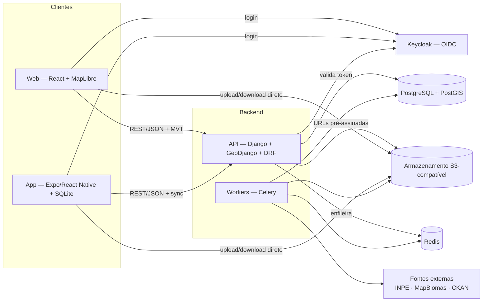

# ADR-0001 — Stack técnica

**Status:** Aceito · **Data:** 2026-10-31 · **Resolve:** [DP-20](../decisoes/pendentes.md#dp-20)
· **Propõe encaminhamento para:** DP-06, DP-07, DP-08, DP-19

## 1. Contexto

Restrições e premissas que guiaram a escolha:

- **Hospedagem indefinida.** O sistema pode rodar em nuvem comercial ou na
  infraestrutura da prefeitura. Todo componente precisa ter opção open source
  auto-hospedável e rodar em containers, sem depender de serviço proprietário.
- **Backend em Python**, por preferência do time e pela força do ecossistema
  geoespacial e de IA.
- **App móvel em React Native**, compartilhando TypeScript com o web.
- O domínio é intensamente **geoespacial** (mapa com ~100 mil árvores, camadas
  municipais, polígonos de alertas, cruzamentos territoriais).
- **Auditoria, proveniência e permissões por território** são requisitos de
  primeira classe (T-01, T-03), não complementos.
- **Operação offline** no app exige identificadores gerados no cliente e
  sincronização idempotente (especificação consolidada §5).
- Ingestão periódica de fontes externas (INPE, MapBiomas, CKAN de Fortaleza).

## 2. Decisão

### 2.1 Visão geral



### 2.2 Componentes

| Camada | Escolha | Função |
| ------ | ------- | ------ |
| Banco de dados | **PostgreSQL + PostGIS** | Dados, geometrias, índices espaciais, geração de vector tiles (`ST_AsMVT`). |
| Backend | **Python + Django (LTS vigente) + GeoDjango** | ORM espacial, migrações, admin interno, autenticação e permissões. |
| API | **Django REST Framework + drf-spectacular** | REST/JSON com contrato OpenAPI gerado do código. |
| Auditoria | **django-pghistory** | Histórico por triggers no banco: captura também alterações em lote e fora do ORM (RN-PROV-002). |
| Tarefas assíncronas | **Celery + Redis** (Celery beat para agendamento) | Ingestão de fontes, importação em lote, miniaturas, exportações, IA. |
| Geoprocessamento | **GeoPandas, Shapely, pyproj, GDAL/OGR** | Normalização de geometria e SRC, importação de CSV/GeoJSON/KML/Shapefile. |
| Arquivos | **Armazenamento S3-compatível** via django-storages | Fotos, documentos, exportações. MinIO auto-hospedado ou S3 de nuvem. |
| Identidade | **Keycloak (OIDC)** | Login, MFA, federação com SSO/LDAP da prefeitura se houver. |
| Web | **React + TypeScript + Vite** (SPA) | Painel autenticado; não há necessidade de SSR/SEO. |
| Rotas web | **TanStack Router** | Parâmetros de URL tipados para filtros e posição do mapa (RF-SHELL-004). |
| Dados web | **TanStack Query** + cliente gerado por **Orval** a partir do OpenAPI | Cache, revalidação e tipos derivados do contrato do backend. |
| Formulários | **React Hook Form + Zod** | Validação no cliente com esquemas compartilháveis com o app. |
| Mapa | **MapLibre GL JS** | Renderização vetorial open source, sem fornecedor obrigatório. |
| Tabelas | **TanStack Table** (+ virtualização) | Listas densas e grandes do inventário. |
| UI | **shadcn/ui (Radix + Tailwind CSS)** com tokens próprios | Componentes acessíveis; tokens Field Operations compartilhados com o app. |
| Gráficos | **Apache ECharts** | Dashboards densos e grandes volumes. |
| App móvel | **Expo (React Native) + expo-sqlite + Drizzle ORM** | Offline-first, câmera, GPS; especificação detalhada em ADR futura. |
| Mapa móvel | **MapLibre React Native** | Mesmo estilo e mesmas fontes de tiles do web. |
| Observabilidade | **OpenTelemetry + Sentry** (auto-hospedável) | Rastreamento, erros, métricas. |
| Empacotamento | **Docker**; Docker Compose em desenvolvimento | Mesmo artefato em nuvem ou on-premise. |
| CI | **GitHub Actions** | Lint, tipos, testes, build de imagens. |

### 2.3 Padrões que a stack impõe

**Identificadores.** UUID gerado no cliente (UUIDv7, ordenável por tempo) para
todas as entidades criadas no web ou no app. Permite criação offline e
retentativas idempotentes.

**Geometria e SRC** (proposta para DP-06):
- Armazenamento em **WGS 84 (EPSG:4326)**, que é o padrão de GPS, GeoJSON e
  MapLibre.
- Cálculos métricos (distâncias, áreas, buffers, proximidade para duplicidade)
  em **SIRGAS 2000 / UTM 24S (EPSG:31984)**, que cobre Fortaleza.
- Dados importados guardam o SRC original nos metadados do lote.

**Vector tiles.** Camadas operacionais (árvores, ocorrências, tarefas) são
servidas por endpoint Django que gera MVT com `ST_AsMVT` **aplicando o escopo
territorial do usuário** (RF-ACL-003). Camadas públicas e estáticas (bairros,
limites) podem ser servidas por um servidor de tiles dedicado (ex.: Martin) ou
arquivos PMTiles, se houver ganho de desempenho.

**Autorização no servidor.** Permissões de módulo/ação via grupos do Django,
mapeados a partir dos papéis do Keycloak. O escopo territorial é aplicado por
gerenciadores de queryset (filtro espacial pelo território do usuário). A
interface só oculta; quem decide é o servidor (RF-ACL-002).

**Arquivos.** Uploads e downloads vão direto ao armazenamento por **URLs
pré-assinadas** de curta duração. A API registra os metadados e o vínculo com a
inspeção ou ocorrência; o armazenamento não fica público.

**Contrato de API.** O OpenAPI gerado pelo backend é a fonte de verdade. O
cliente TypeScript (web e app) é gerado a partir dele; mudança que quebra o
contrato falha na CI.

**Sincronização do app** (detalhar em ADR própria): fila local persistente,
envio por lote com chave de idempotência, confirmação do servidor por registro,
conflitos devolvidos explicitamente. O servidor nunca resolve conflito em
silêncio.

### 2.4 Mapas base (proposta para DP-07)

- **Ruas:** vector tiles a partir do OpenStreetMap. Opção auto-hospedada: um
  arquivo PMTiles do recorte do Ceará (ex.: Protomaps), servido pelo próprio
  armazenamento; exige atribuição ODbL.
- **Satélite:** depende de licença. Avaliar (a) ortofotos municipais, caso
  Fortaleza disponibilize serviço WMS/WMTS, e (b) um provedor comercial com
  licença compatível com uso governamental e com informação de data da imagem
  (RF-MAPA-002).
- MapLibre permite trocar o provedor sem mudar o código das telas.

### 2.5 Organização do repositório

Monorepo único:

```
itree/
├── apps/
│   ├── web/                  # React + Vite
│   └── mobile/               # Expo (quando iniciar)
├── backend/                  # Django (projeto + apps de domínio)
│   ├── config/
│   └── itree/                # territorio, arvores, inspecoes, ocorrencias, ...
├── packages/
│   ├── api-client/           # gerado do OpenAPI (Orval)
│   ├── domain/               # esquemas Zod, enums de estado, vocabulários
│   └── ui-tokens/            # tokens de design compartilhados web/app
├── infra/
│   └── docker/               # compose de desenvolvimento, Dockerfiles
└── docs/
```

- **TypeScript:** pnpm workspaces + Turborepo; ESLint + Prettier; Vitest;
  Playwright para testes ponta a ponta do web.
- **Python:** uv (dependências e ambiente); Ruff (lint/format); mypy com
  django-stubs; pytest + pytest-django.
- Vocabulários fixos (estados de inspeção, status de alerta, classes de origem)
  são definidos uma vez no backend e exportados para `packages/domain` pelo
  OpenAPI, evitando divergência de termos entre web, app e API.

## 3. Alternativas consideradas

| Alternativa | Por que não foi escolhida |
| ----------- | ------------------------- |
| **FastAPI + SQLAlchemy/GeoAlchemy** | Mais leve e assíncrono, mas exigiria montar à mão autenticação, permissões, admin, migrações e auditoria, que o Django já traz. O domínio é CRUD + geo + auditoria, que é o forte do Django. |
| **Backend em TypeScript (NestJS)** | Uma linguagem só, mas ecossistema geoespacial e de IA mais fraco que o Python, e o time prefere Python. |
| **Next.js (SSR)** | O painel é autenticado e não precisa de SEO; SSR adicionaria um servidor Node a operar sem benefício claro. |
| **Mapbox GL JS / Google Maps** | Licença e custo atrelados ao fornecedor. MapLibre mantém a liberdade de provedor (DP-07). |
| **Leaflet** | Simples, mas sem renderização vetorial em GPU; fraco para ~100 mil pontos e estilização dinâmica. |
| **GeoServer como camada de mapas** | Muito capaz para OGC, mas pesado de operar; o escopo por usuário seria mais difícil. Pode entrar depois só para publicar camadas OGC, se necessário. |
| **Auth0, Cognito, Firebase Auth** | Bons serviços gerenciados, mas não auto-hospedáveis; incompatíveis com a hipótese de rodar na infraestrutura da prefeitura. |
| **Supabase/Firebase como backend** | Aceleram o início, mas regras de domínio, auditoria e escopo territorial ficariam espalhadas em políticas de banco e funções. |
| **Flutter ou nativo no app** | Não compartilham código com o web. |

## 4. Consequências

**Positivas**
- Tudo é open source e roda em containers: a decisão de hospedagem pode ficar
  para depois sem retrabalho.
- PostGIS concentra consultas espaciais, tiles e cruzamentos territoriais em um
  único lugar consistente com as permissões.
- O contrato OpenAPI com cliente gerado reduz divergência entre backend, web e
  app.
- A auditoria por trigger cobre alterações que a auditoria pelo ORM perderia.

**Negativas e riscos**
- Duas linguagens (Python e TypeScript) exigem tooling e CI para ambas.
- Keycloak é mais um serviço a operar. Se a prefeitura já tiver um provedor
  OIDC, o Keycloak pode ser dispensado ou apenas federar com ele.
- Tiles geradas pelo Django precisam de cache; carga alta exige cache por
  território e zoom ou um servidor de tiles dedicado.
- A estratégia de sincronização offline é a parte mais arriscada e ainda
  depende de ADR própria antes de iniciar o app.

## 5. Próximas ADRs

- ADR-0002 — Protocolo de sincronização offline (app ↔ API).
- ADR-0003 — Provedor de mapas base e imagem de satélite (fecha DP-07).
- ADR-0004 — Hospedagem e implantação (quando a hospedagem for definida).
