# Arquitetura — modelo C4

Diagramas da Engine de Inteligência Arbórea no modelo [C4](https://c4model.com/):
contexto, contêineres, componentes, implantação e fluxos dinâmicos. Eles
descrevem **o que está implementado**: o painel web (F0 a F3) e o que veio depois,
como detecção automática, conectores, imóveis, população e a regra 3-30-300. O que
ainda é plano aparece tracejado e marcado como _planejado_. O rumo atual (pesquisa
e ONG, nada público) está em [decisões de 21/11/2026](../decisoes/2026-11-21-rumo-do-produto.md).

As decisões por trás das escolhas estão nos ADRs
([ADR-0001 — stack](../adr/0001-stack-tecnica.md),
[ADR-0002 — identidade e autorização](../adr/0002-identidade-e-autorizacao.md)).
As decisões ainda abertas estão em [`decisoes/pendentes.md`](../decisoes/pendentes.md).

Os diagramas são Mermaid: o GitHub os renderiza direto nesta página. Para
editar, altere o bloco de código; não há imagem gerada para manter em dia.

**Legenda.** Azul-escuro = pessoa; verde = contêiner ou componente deste
sistema; cinza = sistema externo; borda tracejada = planejado, ainda não
implementado.

---

## Nível 1 — Contexto do sistema

Quem usa a plataforma e com que sistemas ela conversa.

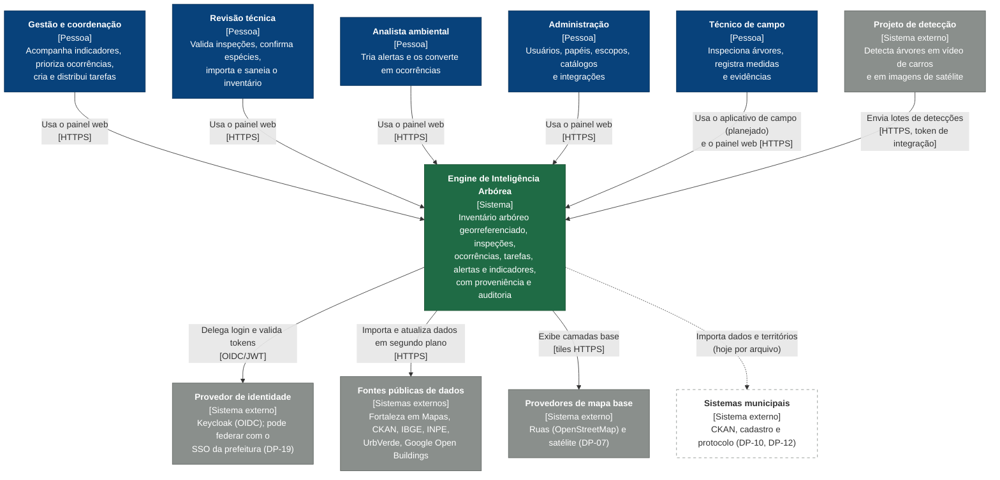

Pontos do contexto:

- **Ninguém de fora da prefeitura acessa o sistema.** Não há portal público
  nem canal de cidadão nesta fase.
- **A base de árvores vem, em boa parte, de detecção automática.** Um projeto
  externo envia lotes pela API ou por pacote ZIP. A detecção entra direto no
  inventário, com selo de confiança e origem, e a inspeção ou a revisão humana a
  confirma. O contrato está em
  [detecção automática](../integracoes/deteccao-automatica.md).
- **Alertas externos são sinais, não conclusões.** O sistema registra a fonte
  e o horário da detecção, e a decisão é sempre humana (W-08).
- **Território.** Bairros e limites municipais entram por importação
  (`importar_territorios`), com fonte e data de referência registradas.
- **Fontes públicas.** O que cada fonte alimenta, o comando de importação, a
  periodicidade e a licença estão no [índice de integrações](../integracoes/README.md).
- **Áreas verdes.** Praças, parques urbanos e unidades de conservação entram
  pelo comando `importar_areas_verdes`, a partir da API do Fortaleza em Mapas
  (mapas 99, 86 e 737), com fonte, licença, data de referência e data de
  ingestão. São camada de contexto: não alteram o inventário. A ficha da árvore
  informa a área verde que a contém.

---

## Nível 2 — Contêineres

Os processos e armazenamentos que compõem o sistema.

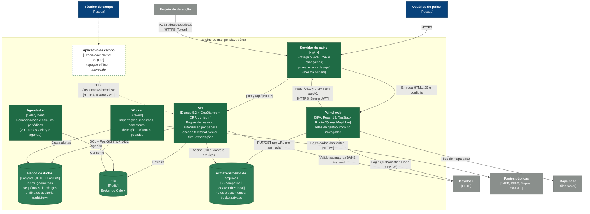

| Contêiner | Tecnologia | Código | Imagem |
| --- | --- | --- | --- |
| Painel web + servidor | React + Vite, servido por nginx | `apps/web` | `apps/web/Dockerfile` |
| API | Django + DRF em gunicorn | `backend/` | `backend/Dockerfile` (papel `api`) |
| Worker / agendador | Celery worker / beat | `backend/itree/*/tasks.py`, agenda em `backend/config/settings.py` | mesma imagem (papéis `worker`, `beat`) |
| Banco | PostgreSQL 16 + PostGIS 3.4 | migrações em `backend/itree/*/migrations` | `postgis/postgis` |
| Fila | Redis 7 | — | `redis` |
| Arquivos | S3-compatível (SeaweedFS no ambiente local) | `backend/itree/core/armazenamento.py` | `chrislusf/seaweedfs` |
| Identidade | Keycloak 26 (realm `itree`) | `infra/docker/keycloak/` | `keycloak/keycloak` |

Escolhas que os diagramas não mostram:

- **Mesma origem.** O navegador fala só com o nginx, que repassa `/api/` à API.
  Por isso o navegador não precisa de CORS.
- **Arquivos não passam pela API.** A API cria a evidência, devolve uma URL
  pré-assinada com tamanho e tipo fixados, e depois confere o objeto no bucket
  antes de marcar a evidência como disponível.
- **O trabalho pesado roda no Celery.** A confirmação de importação com mais de
  500 linhas válidas, lotes de detecção com mais de 200 detecções, ações em lote
  grandes, sincronização de conectores, reimportação das fontes e cálculo da
  regra 3-30-300 vão para o worker. Abaixo desses limites, a própria requisição
  resolve (200 ou 201); acima, a API responde 202 e a tela acompanha a situação.
  As exportações continuam síncronas e avisam quando o resultado foi cortado.
- **Contrato da API.** O `openapi.yaml` é gerado do código (drf-spectacular),
  e o cliente TypeScript (`packages/api-client`) é gerado dele (Orval). O CI
  falha se algum dos dois estiver desatualizado.

---

## Nível 3 — Componentes da API

Cada app Django é um componente com fronteira própria. Todas as rotas passam
pela mesma cadeia de autenticação, autorização e auditoria.

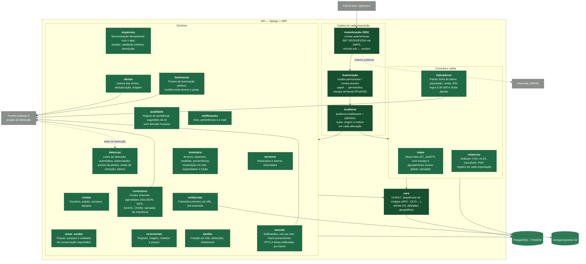

Regras transversais, aplicadas em todos os componentes:

- **Escopo territorial no servidor.** Listas, tiles, busca e exportações
  filtram por interseção com a área do usuário (`filtrar_por_escopo`). As
  escritas validam o ponto com `ponto_no_escopo`. A união das áreas é
  calculada uma vez por requisição.
- **Proveniência.** Cada valor guarda a própria origem (medido, estimado,
  importado, sugerido por IA), e a localização guarda como foi obtida.
- **Auditoria append-only.** As triggers do pghistory gravam cada alteração
  junto com o contexto da requisição (usuário, origem web/app e motivo).

### Apps Django e responsabilidades

Cada app tem um módulo `tasks.py` só quando roda algo em segundo plano.

| App | Responsabilidade |
| --- | --- |
| `core` | Modelo base (UUIDv7), sequências de códigos, cliente S3, utilidades geográficas, paginação e ações em lote em segundo plano |
| `contas` | Usuários, papéis, escopo territorial, equipes, autenticação OIDC e matriz de permissões |
| `auditoria` | Contexto da requisição para a trilha (pghistory) e consulta da auditoria |
| `territorio` | Município, regionais e bairros; ficha do bairro; importação dos limites oficiais |
| `areas_verdes` | Praças, parques e unidades de conservação; subtipos; conferência com o CNUC; adoção de praças |
| `inventario` | Árvores, espécies e suas referências (Wikidata, Commons, GBIF), medidas, importação de bases legadas, duplicidades e histórico visual |
| `evidencias` | Fotos e documentos por URL pré-assinada, com miniaturas |
| `ocorrencias`, `inspecoes`, `tarefas` | Fluxo operacional: registro, inspeção em campo (sincronização idempotente) e tarefas |
| `alertas` | Focos de calor e supressão de vegetação (INPE), PRODES Caatinga, deduplicação e triagem humana |
| `notificacoes` | Notificações no sino e por e-mail, preferências e retenção |
| `qualidade` | Regras de pendência de dados e registro de sugestões de IA com decisão humana |
| `deteccao` | Recebimento de lotes de detecção automática (API e pacote ZIP), selo de confiança, junção à árvore mais próxima, pontos de plantio e sinais de remoção |
| `conectores` | Fontes externas agendadas com hosts permitidos e bloqueio de rede interna; destino em camada de referência ou lote em prévia |
| `iluminacao` | Pontos de iluminação pública (SEINF) e árvores a até o raio provisório de um poste |
| `imoveis` | Edificações (Google Open Buildings), uso por lote (SEFIN), macrozoneamento, IPTU e áreas edificadas por bairro |
| `indicadores` | Painel da visão geral, instantâneos diários, indicadores externos por bairro (Censo, IDH, renda, ilha de calor), regra 3-30-300, "Onde plantar" e dados da URBFOR |
| `mapa` | Vector tiles com escopo, busca global, camadas, linha do tempo e seleção por área |
| `relatorios` | Análises, exportações (CSV, XLSX, GeoJSON, PDF) e registro de cada exportação |

### Vector tiles do mapa

`GET /api/v1/mapa/tiles/{camada}/{z}/{x}/{y}` gera o tile no PostGIS com
`ST_AsMVT`, já recortado pelo escopo do usuário. As camadas são `arvores`,
`ocorrencias`, `tarefas`, `iluminacao`, `edificacoes` e `macrozoneamento`; cada
uma exige a permissão própria. As regras principais estão em
`backend/itree/mapa/views.py`:

- **Árvores, ocorrências e tarefas:** abaixo do zoom 12, as árvores vêm
  agrupadas por bairro; abaixo do 16, em células com a contagem; a partir do 16,
  uma feição por registro. Árvores e ocorrências aceitam `ate` (linha do tempo).
- **Iluminação e edificações:** centenas de milhares de feições, sem
  agrupamento, só a partir do zoom 15. Abaixo dele o tile vem vazio.
- **Camadas de referência dos conectores** e a camada de população por bairro
  não são MVT: vão em GeoJSON. A ilha de calor é WMS, direto do servidor da
  UrbVerde.

### Tarefas Celery e agenda

O `beat` lê `CELERY_BEAT_SCHEDULE` em `backend/config/settings.py`, no fuso
`America/Fortaleza`. Só uma instância do `beat` deve rodar.

| Tarefa agendada | Quando | O que faz |
| --- | --- | --- |
| `registrar_indicadores` | todo dia, 01:30 | Grava os instantâneos da visão geral por território |
| `limpar_notificacoes_antigas` | todo dia, 02:15 | Apaga notificações vencidas pela retenção |
| `retomar_referencias_com_erro` | todo dia, 05:45 | Tenta de novo as referências de espécies que falharam |
| `disparar_conectores_vencidos` | de hora em hora (minuto 10) | Sincroniza os conectores cuja periodicidade venceu |
| `atualizar_referencias_antigas` | dia 1, 03:30 | Renova as referências de espécies mais antigas |
| `reimportar_areas_verdes` | dia 2, 04:00 | Praças, parques e unidades de conservação |
| `reimportar_adocao_pracas` | dia 2, 04:30 | Adoção de praças |
| `reimportar_iluminacao_publica` | dia 3, 04:00 | Pontos de iluminação pública |
| `reimportar_dados_imobiliarios` | dia 4, 04:40 | IPTU, áreas edificadas e macrozoneamento; depois chama o cálculo 3-30-300 |
| `renovar_fontes_populacao` | dia 6, 05:00 | Confere população, renda, estimativa e IDH e reimporta o que mudou |
| `calcular_3_30_300` | dia 7, 06:20 | Recalcula a regra 3-30-300 por bairro |
| `reimportar_ilha_calor` | 5 de fevereiro, 05:00 | Ilha de calor por bairro (só grava com `URBVERDE_GRAVAR_VALORES`) |
| `ingerir_fontes_configuradas` | a cada `ALERTAS_INTERVALO_HORAS` (padrão 6) | Só existe se `ALERTAS_FONTES` não estiver vazio |

Tarefas sob demanda, disparadas pela API ou por outra tarefa:
`confirmar_importacao` (importação grande), `processar_lote` (detecção),
`sincronizar_conector`, `executar_operacao_em_lote`, `atualizar_referencias_especie`
e `enviar_email_notificacao`.

### Componentes do painel web

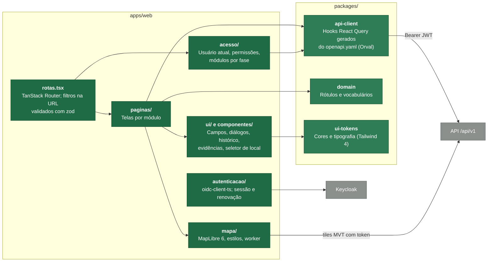

---

## Implantação

### Ambiente local (`infra/docker/compose.yml`)

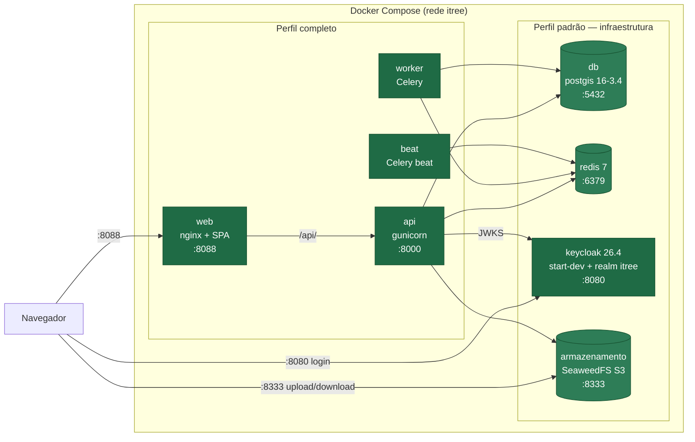

Sem o perfil `completo`, só a infraestrutura sobe: a API roda no host
(`uv run python manage.py runserver`) e o painel no Vite (`pnpm dev`). Os
comandos estão no [README da infra](../../infra/README.md).

### Produção (referência; a hospedagem ainda é a DP-21)

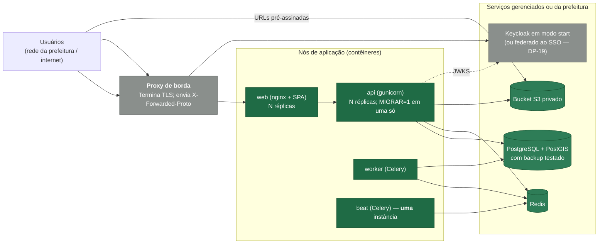

O checklist de produção (segredos, cookies seguros, HSTS, CSP com origens
exatas) está no [README da infra](../../infra/README.md#produção-checklist).

---

## Fluxos dinâmicos

### Login e chamada autenticada

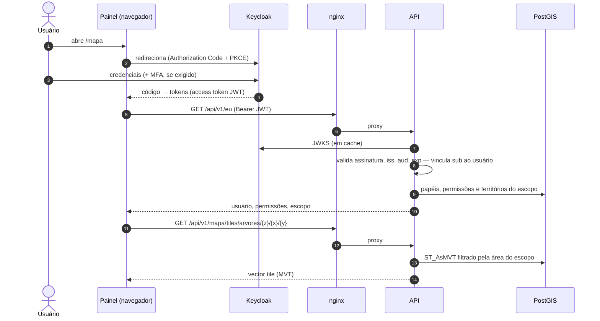

### Envio de evidência (foto)

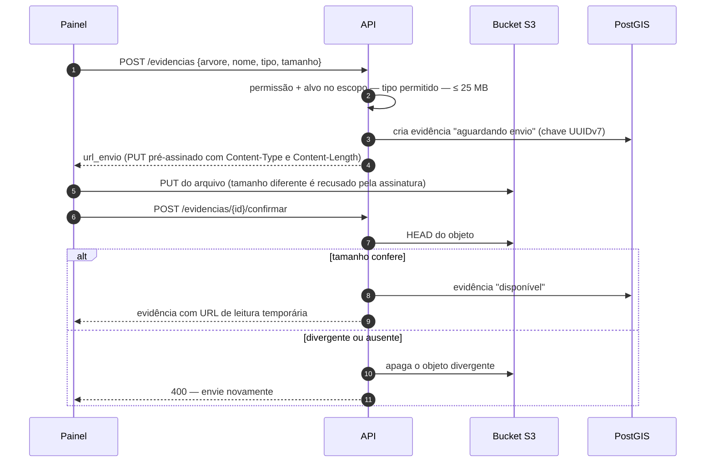

### Sincronização de inspeções (aplicativo de campo)

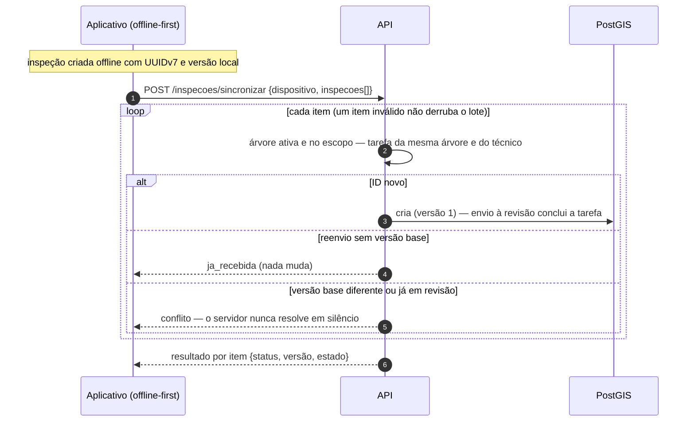

### Ingestão de alertas ambientais

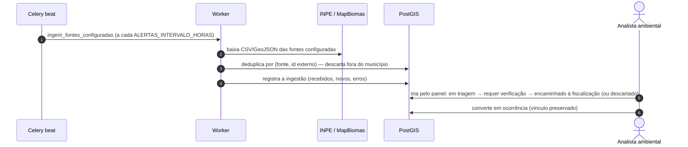

A administração também pode enviar o arquivo de uma fonte pelo painel
(Administração › Integrações). O caminho de ingestão é o mesmo.

### Importação de fontes públicas

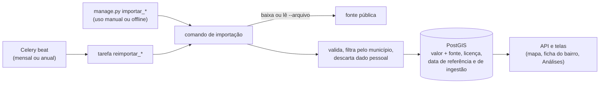

Todo importador é **idempotente** e grava a proveniência junto do dado. Se a
fonte falha, a importação atômica não muda nada e a falha sobe para o Celery;
o aviso de "fonte desatualizada" aparece quando a última importação passa do
limite. A lista de fontes está no [índice de integrações](../integracoes/README.md).

### Conectores de fontes externas

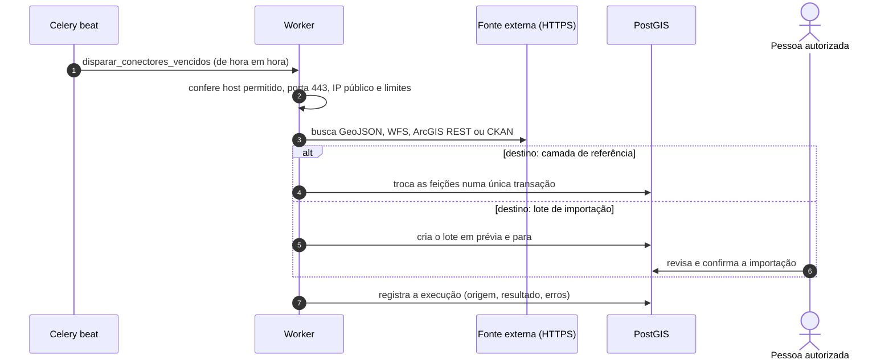

### Detecção automática

```mermaid
sequenceDiagram
    autonumber
    participant D as Projeto de detecção
    participant API as API
    participant W as Worker
    participant DB as PostGIS
    actor R as Pessoa na revisão

    D->>API: POST /deteccoes/lotes (JSON ou multipart) ou pacote ZIP
    API->>API: valida o contrato, guarda as fotos aceitas, registra o lote
    alt até DETECCAO_LIMITE_SINCRONO detecções
        API->>DB: processa na requisição (201)
    else lote grande
        API->>W: processar_lote (202; a origem acompanha a situação)
        W->>DB: processa em blocos, com ponto de retomada
    end
    Note over DB: junta a observação à árvore ativa mais próxima<br/>ou cria árvore nova, com selo de confiança e origem
    Note over DB: berço vazio e toco viram ponto de plantio;<br/>árvore conhecida não vista vira sinal de possível remoção
    R->>DB: confirma a árvore ou decide sobre a remoção
```

Nada é removido sozinho: o sinal de remoção só pede revisão humana. Os selos
(baixa, média, alta) e os raios de junção vêm de configuração
([variáveis de ambiente](../desenvolvimento.md#variáveis-de-ambiente)).
