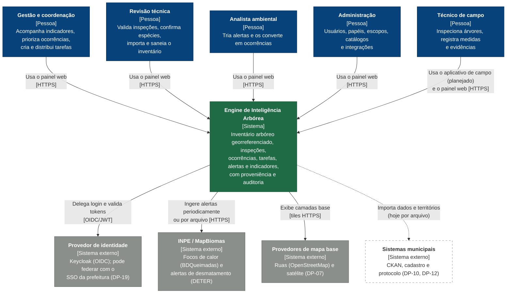
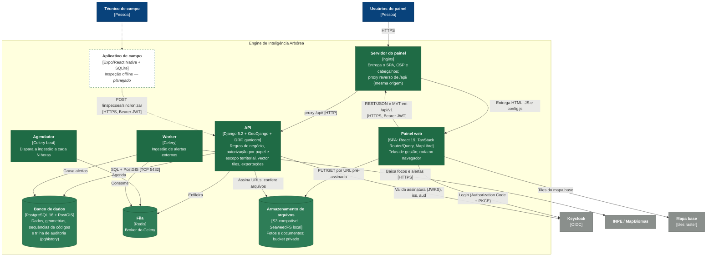
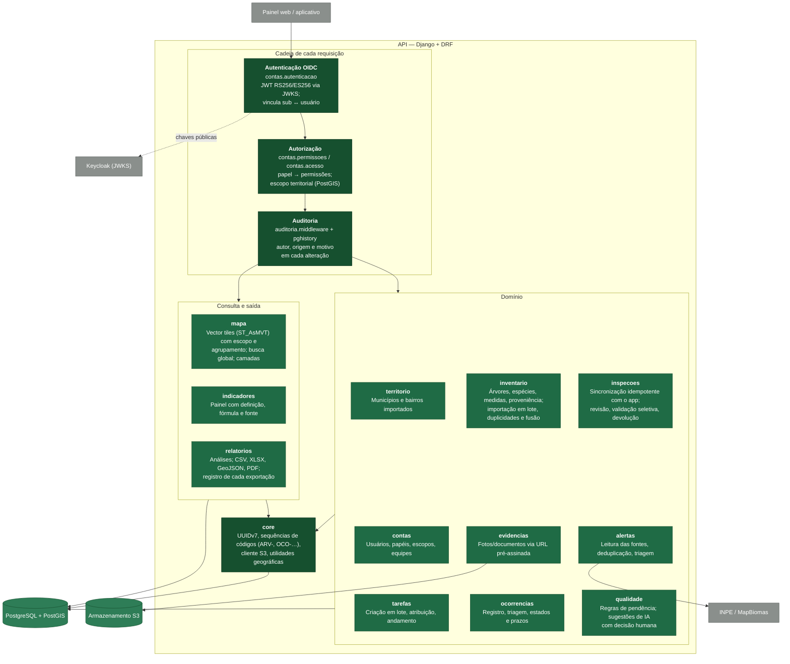
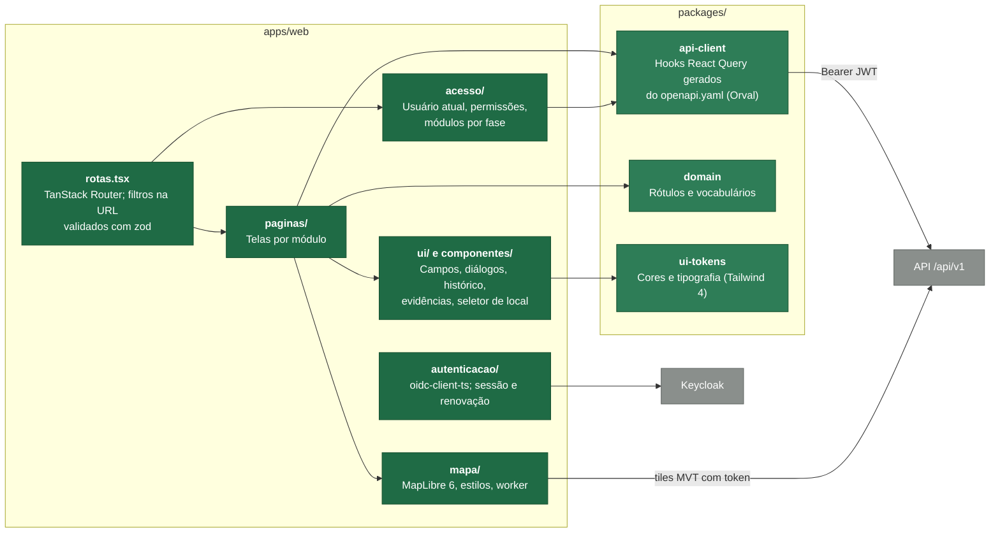
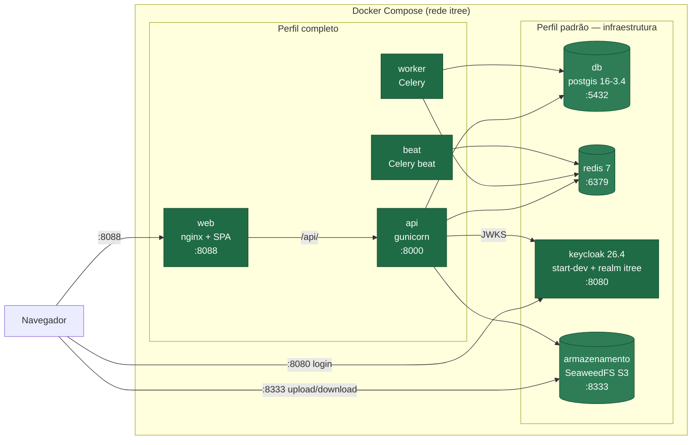
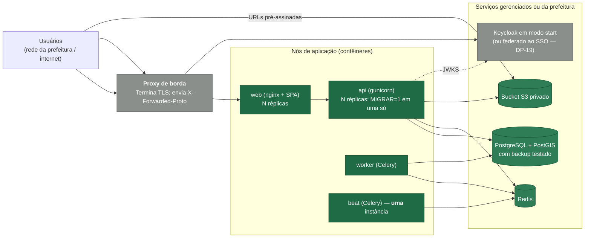
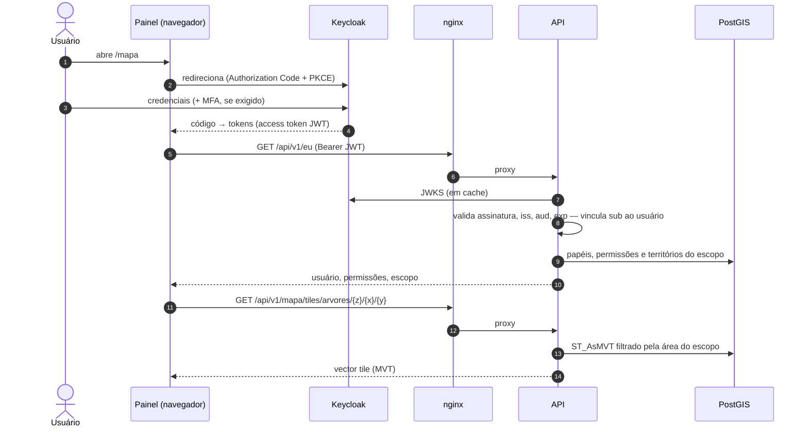
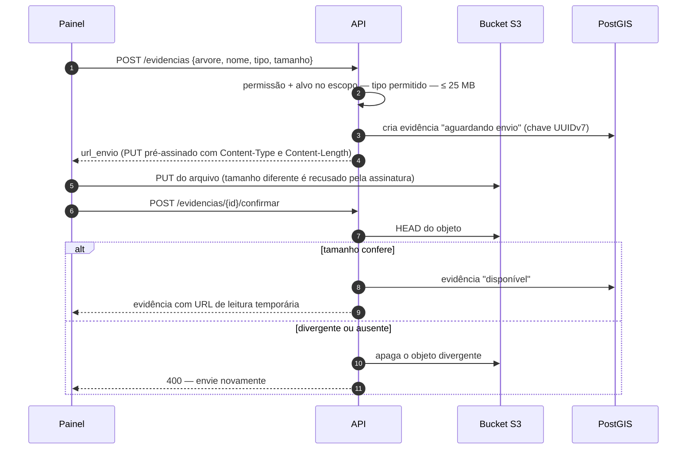
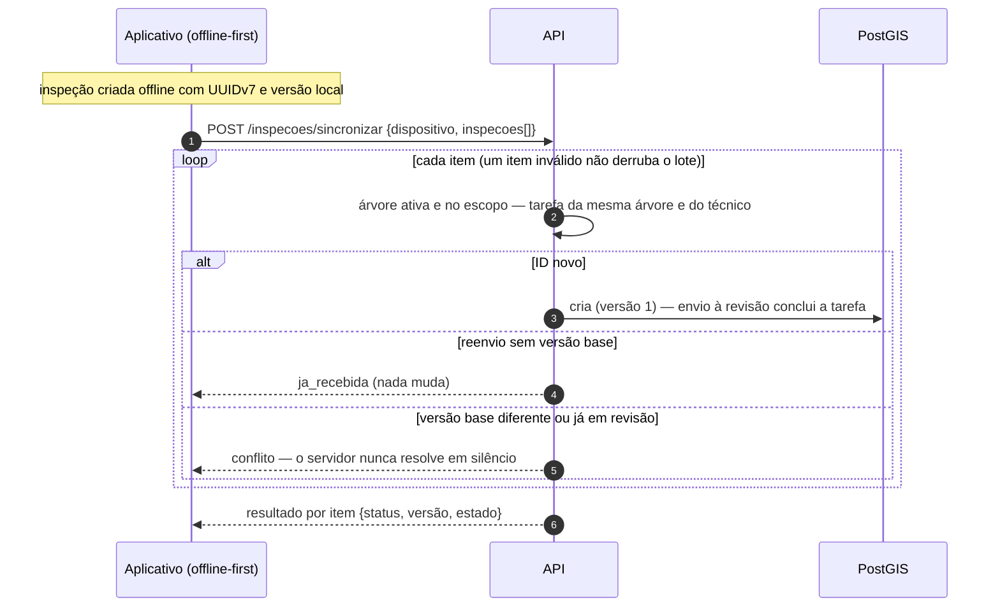
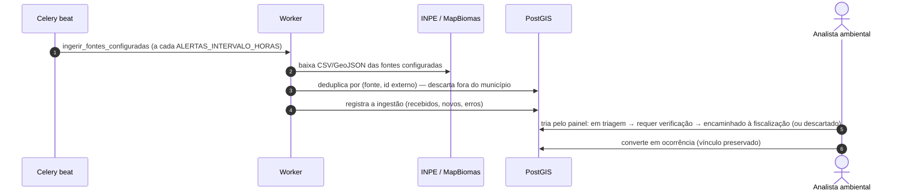

# Arquitetura — modelo C4

Diagramas da Engine de Inteligência Arbórea no modelo [C4](https://c4model.com/):
contexto, contêineres, componentes, implantação e fluxos dinâmicos. Eles
descrevem **o que está implementado** (fases F0–F3 do painel web). O que ainda
é plano aparece tracejado e marcado como _planejado_.

As decisões por trás das escolhas estão nos ADRs
([ADR-0001 — stack](../adr/0001-stack-tecnica.md),
[ADR-0002 — identidade e autorização](../adr/0002-identidade-e-autorizacao.md)).
As decisões ainda abertas estão em [`decisoes/pendentes.md`](../decisoes/pendentes.md).

Os diagramas são Mermaid: o GitHub os renderiza direto nesta página. Para
editar, altere o bloco de código; não há imagem gerada para manter em dia.

**Legenda.** Azul-escuro = pessoa; verde = contêiner ou componente deste
sistema; cinza = sistema externo; borda tracejada = planejado, ainda não
implementado.

---

## Nível 1 — Contexto do sistema

Quem usa a plataforma e com que sistemas ela conversa.

Pontos do contexto:

- **Ninguém de fora da prefeitura acessa o sistema.** Não há portal público
  nem canal de cidadão nesta fase.
- **Alertas externos são sinais, não conclusões.** O sistema registra a fonte
  e o horário da detecção, e a decisão é sempre humana (W-08).
- **Território.** Bairros e limites municipais entram por importação
  (`importar_territorios`), com fonte e data de referência registradas.

---

## Nível 2 — Contêineres

Os processos e armazenamentos que compõem o sistema.

| Contêiner | Tecnologia | Código | Imagem |
| --- | --- | --- | --- |
| Painel web + servidor | React + Vite, servido por nginx | `apps/web` | `apps/web/Dockerfile` |
| API | Django + DRF em gunicorn | `backend/` | `backend/Dockerfile` (papel `api`) |
| Worker / agendador | Celery worker / beat | `backend/itree/alertas/tasks.py` | mesma imagem (papéis `worker`, `beat`) |
| Banco | PostgreSQL 16 + PostGIS 3.4 | migrações em `backend/itree/*/migrations` | `postgis/postgis` |
| Fila | Redis 7 | — | `redis` |
| Arquivos | S3-compatível (SeaweedFS no ambiente local) | `backend/itree/core/armazenamento.py` | `chrislusf/seaweedfs` |
| Identidade | Keycloak 26 (realm `itree`) | `infra/docker/keycloak/` | `keycloak/keycloak` |

Escolhas que os diagramas não mostram:

- **Mesma origem.** O navegador fala só com o nginx, que repassa `/api/` à API.
  Por isso o navegador não precisa de CORS.
- **Arquivos não passam pela API.** A API cria a evidência, devolve uma URL
  pré-assinada com tamanho e tipo fixados, e depois confere o objeto no bucket
  antes de marcar a evidência como disponível.
- **Importação e exportação são síncronas** na API. Os limites ficam em 50 mil
  linhas por arquivo, e a exportação avisa quando o resultado foi cortado. O
  Celery hoje só cuida dos alertas; tarefas longas podem migrar para ele.
- **Contrato da API.** O `openapi.yaml` é gerado do código (drf-spectacular),
  e o cliente TypeScript (`packages/api-client`) é gerado dele (Orval). O CI
  falha se algum dos dois estiver desatualizado.

---

## Nível 3 — Componentes da API

Cada app Django é um componente com fronteira própria. Todas as rotas passam
pela mesma cadeia de autenticação, autorização e auditoria.

Regras transversais, aplicadas em todos os componentes:

- **Escopo territorial no servidor.** Listas, tiles, busca e exportações
  filtram por interseção com a área do usuário (`filtrar_por_escopo`). As
  escritas validam o ponto com `ponto_no_escopo`. A união das áreas é
  calculada uma vez por requisição.
- **Proveniência.** Cada valor guarda a própria origem (medido, estimado,
  importado, sugerido por IA), e a localização guarda como foi obtida.
- **Auditoria append-only.** As triggers do pghistory gravam cada alteração
  junto com o contexto da requisição (usuário, origem web/app e motivo).

### Componentes do painel web

---

## Implantação

### Ambiente local (`infra/docker/compose.yml`)

Sem o perfil `completo`, só a infraestrutura sobe: a API roda no host
(`uv run python manage.py runserver`) e o painel no Vite (`pnpm dev`). Os
comandos estão no [README da infra](../../infra/README.md).

### Produção (referência; a hospedagem ainda é a DP-21)

O checklist de produção (segredos, cookies seguros, HSTS, CSP com origens
exatas) está no [README da infra](../../infra/README.md#produção-checklist).

---

## Fluxos dinâmicos

### Login e chamada autenticada

### Envio de evidência (foto)

### Sincronização de inspeções (aplicativo de campo)

### Ingestão de alertas ambientais

A administração também pode enviar o arquivo de uma fonte pelo painel
(Administração › Integrações). O caminho de ingestão é o mesmo.
