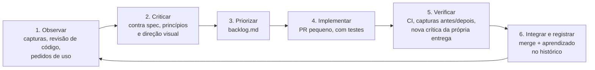

# Ciclo de melhoria contínua

Como o produto melhora entre as fases do roadmap: cada volta do ciclo pega um
problema concreto, observado numa tela ou num relatório, e o resolve num PR
pequeno que pode ser verificado.

## As etapas

1. **Observar.** As fontes são:
   - as capturas de [`docs/telas/`](../telas/README.md), regeneradas por `scripts/telas/gerar.sh`;
   - a revisão de prontidão do repositório (skill de revisão de projeto);
   - os PRs do Dependabot;
   - os pedidos de quem usa o sistema.
2. **Criticar.** Cada achado é comparado com:
   - as specs (`docs/specs/`), que ganham de qualquer referência visual;
   - os [princípios e a direção visual](direcao-visual.md);
   - as decisões pendentes (`docs/decisoes/pendentes.md`), sem antecipar o que ainda não foi decidido.
3. **Priorizar.** O achado entra no [backlog](backlog.md) com o problema, o efeito para quem usa, a regra afetada e um critério de pronto verificável. A ordem considera o efeito para o usuário e as dependências, não a facilidade.
4. **Implementar.** Um PR por item, ou por grupo coeso de itens. Toda regra nova de servidor vem com teste que falha sem a correção.
5. **Verificar.**
   - O CI precisa passar.
   - As capturas afetadas são regeneradas, e o PR mostra o antes e o depois.
   - A própria entrega passa por uma nova crítica antes do merge: o que ainda está ruim volta para o backlog, sem bloquear o PR.
6. **Integrar e registrar.** Merge e uma linha no histórico abaixo, com o que mudou e o que se aprendeu.

## Regras do ciclo

- **Nada de confiança de IA, "saúde" atribuída por IA ou números ambientais sem fonte e método** (DP-13; RN de proveniência), mesmo quando aparecem nas referências visuais.
- **Dados de demonstração são sempre sintéticos** e declarados como tal.
- **Dependências:**
  - Atualizações menores e de segurança entram pelo Dependabot, se o CI passar.
  - Saltos de versão maior (Django, Python, Node) são planejados no backlog, com alinhamento entre imagem, CI e lock.
- **Ambiente:** quando falta acesso de rede ou ferramenta, o item fica registrado e a pessoa responsável pelo ambiente é avisada. Nunca se inventa o resultado que faltou.

## Histórico

| Data | Iteração | O que mudou | Aprendizado |
| --- | --- | --- | --- |
| 2026-11-01 | Revisão de prontidão | 29 achados corrigidos: escopo territorial, importação, exportações, cabeçalhos, CI e acessibilidade (#7) | O gate de citações literais da revisão separa achado real de opinião. Com testes que falham sem a correção, o merge fica seguro. |
| 2026-11-01 | Documentação visual | Diagramas C4 e 30 capturas reproduzíveis (#17, #18) | Gerar as capturas expôs uma regressão (link do mapa com "Todas"). Capturas também servem de teste. |
| 2026-11-01 | 1 — Mapa | Mapa base OSM discreto; cor por condição aparente; forma por origem; ícones para ocorrência, tarefa e alerta; agrupamentos com contagem; nomes de bairro; painel e legenda flutuantes; foto no painel da árvore | Células de agrupamento com um registro perdiam as propriedades e apagavam a cor em zoom médio. Só a captura mostrou isso; o teste passou a cobrir. |
| 2026-11-01 | 2 — Catálogo de espécies | Grade e detalhe de espécies; cartão na ficha da árvore; referências do Wikidata, Wikipedia, Commons e GBIF com autoria, licença e data; comando, tarefa e ação de atualização | Correspondência exata pelo P225 do Wikidata evita "achar parecido". A captura mostrou família e origem vazias na semeadura, corrigidas na mesma iteração. Os dados reais dependem de liberar a rede (M-01b). |
