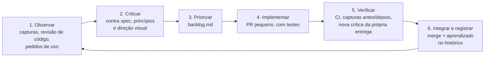

# Ciclo de melhoria contínua

Como o produto melhora entre as fases do roadmap: cada volta do ciclo pega um
problema concreto, observado numa tela ou num relatório, e o resolve num PR
pequeno que pode ser verificado.

## As etapas

1. **Observar.** As fontes são:
   - as capturas de [`docs/telas/`](../telas/README.md), regeneradas por `scripts/telas/gerar.sh`;
   - a revisão de prontidão do repositório (skill de revisão de projeto);
   - os PRs do Dependabot;
   - os pedidos de quem usa o sistema.
2. **Criticar.** Cada achado é comparado com:
   - as specs (`docs/specs/`), que ganham de qualquer referência visual;
   - os [princípios e a direção visual](direcao-visual.md);
   - as decisões pendentes (`docs/decisoes/pendentes.md`), sem antecipar o que ainda não foi decidido.
3. **Priorizar.** Antes de executar, estime o custo em tokens e escolha a estratégia (paralelismo, lotes, modelo), conforme as [estimativas](estimativas.md). O achado entra no [backlog](backlog.md) com o problema, o efeito para quem usa, a regra afetada e um critério de pronto verificável. A ordem considera o efeito para o usuário e as dependências, não a facilidade.
4. **Implementar.** Um PR por item, ou por grupo coeso de itens. Toda regra nova de servidor vem com teste que falha sem a correção.
5. **Verificar.**
   - O CI precisa passar.
   - As capturas afetadas são regeneradas, e o PR mostra o antes e o depois.
   - A própria entrega passa por uma nova crítica antes do merge: o que ainda está ruim volta para o backlog, sem bloquear o PR.
6. **Integrar e registrar.** Merge e uma linha no histórico abaixo, com o que mudou e o que se aprendeu. Registre também o estimado e o real em [estimativas](estimativas.md) e ajuste a regra prática quando o erro passar de 25%.

## Regras do ciclo

- **Nada de confiança de IA, "saúde" atribuída por IA ou números ambientais sem fonte e método** (DP-13; RN de proveniência), mesmo quando aparecem nas referências visuais.
- **Dados de demonstração são sempre sintéticos** e declarados como tal.
- **Dependências:**
  - Atualizações menores e de segurança entram pelo Dependabot, se o CI passar.
  - Saltos de versão maior (Django, Python, Node) são planejados no backlog, com alinhamento entre imagem, CI e lock.
- **Ambiente:** quando falta acesso de rede ou ferramenta, o item fica registrado e a pessoa responsável pelo ambiente é avisada. Nunca se inventa o resultado que faltou.

## Histórico

| Data | Iteração | O que mudou | Aprendizado |
| --- | --- | --- | --- |
| 2026-11-01 | Revisão de prontidão | 29 achados corrigidos: escopo territorial, importação, exportações, cabeçalhos, CI e acessibilidade (#7) | O gate de citações literais da revisão separa achado real de opinião. Com testes que falham sem a correção, o merge fica seguro. |
| 2026-11-01 | Documentação visual | Diagramas C4 e 30 capturas reproduzíveis (#17, #18) | Gerar as capturas expôs uma regressão (link do mapa com "Todas"). Capturas também servem de teste. |
| 2026-11-01 | 1 — Mapa | Mapa base OSM discreto; cor por condição aparente; forma por origem; ícones para ocorrência, tarefa e alerta; agrupamentos com contagem; nomes de bairro; painel e legenda flutuantes; foto no painel da árvore | Células de agrupamento com um registro perdiam as propriedades e apagavam a cor em zoom médio. Só a captura mostrou isso; o teste passou a cobrir. |
| 2026-11-01 | 2 — Catálogo de espécies | Grade e detalhe de espécies; cartão na ficha da árvore; referências do Wikidata, Wikipedia, Commons e GBIF com autoria, licença e data; comando, tarefa e ação de atualização | Correspondência exata pelo P225 do Wikidata evita "achar parecido". A captura mostrou família e origem vazias na semeadura, corrigidas na mesma iteração. Os dados reais dependem de liberar a rede (M-01b). |
| 2026-11-02 | 2b — Referências reais | Consulta real ao Wikidata, Wikipedia e Commons. Respeita o limite de taxa (429 + Retry-After). Erro da API com status 200 deixa de ser lido como "não encontrada". Sintaxe correta do haswbstatement. Imagem copiada e reduzida no armazenamento da plataforma. | Os testes com respostas simuladas passavam com uma consulta que, na prática, nunca encontrava nada. Só o uso real revelou isso, e cada erro virou um teste fixando o formato real. |
| 2026-11-02 | 2c — Imagens das espécies | Com `thumb.wikimedia.org` liberado, as 8 espécies ganharam cópia local (até 960 px) com autor e licença; capturas 31 e 32 refeitas | A Wikimedia limita downloads de originais, mas serve bem miniaturas em tamanho padrão: buscar primeiro a miniatura é o caminho que respeita a política dela. |
| 2026-11-09 | 3 — Visão geral | Barra lateral verde-escura; cartões em destaque com ícone e variação contra o período anterior; mapa resumido pela condição; "Alertas e pendências" acionáveis; gráfico mensal de inspeções e ocorrências (com tabela); condição aparente em barra segmentada | O verde da marca falhou no validador de paleta para série de gráfico (croma baixo). As séries usam o par azul/laranja validado, e o verde fica para a identidade. |
| 2026-11-11 | 4 — Backlog P2/P3 | Grupos do mapa com anel da pior condição (M-07). Artigo da Wikipedia pelo nome científico, aceitando sinônimo declarado na caixa taxonômica (M-10). Tendência dos instantâneos com registro diário e sparkline (M-11). Bairro buscado em destaque (M-05). Seleção por área com criação de tarefas e exportação (M-03). Atualização mensal das referências e link da Flora e Funga do Brasil via P10701 (M-09). Contraste AA dos tokens verificado na CI (M-08). Python 3.14 e Node 24 (D-02/D-03). Os itens foram implementados por subagentes, com revisão e correção antes do merge. | O "P225 idêntico" exigido no M-10 rejeitava o caso real: o artigo "Oiti" trata do nome aceito, *Moquilea tomentosa*, e cita *Licania tomentosa* como sinônimo. Só a consulta real mostrou isso. Revisar a entrega de cada subagente contra a API real foi o que pegou o problema. |
| 2026-11-11 | 5 — Crítica das telas e fontes públicas | 41 achados da crítica das 35 capturas, corrigidos em 6 lotes paralelos: histórico legível, datas dd/mm/aaaa, plurais, pendências na primeira dobra, painel do mapa e ações por linha. Segunda onda: notificações, migalhas, seletor de território, árvores próximas a alertas, ficha com mini-mapa e foto, seleção em lote, gráficos nas análises. Fontes públicas verificadas de verdade: limites oficiais de Fortaleza com código IBGE, focos diários do INPE, 527 áreas verdes oficiais e arborização do entorno do Censo 2022 (50,4% das faces de quadra com árvore). | Integrar seis lotes paralelos exigiu rebase e verificação completa a cada merge: conflitos aditivos em `formatos.ts` eram triviais, mas os testes quebraram por mudanças de outro lote (datas mascaradas, legenda recolhida). Só o dado real mostrou as UCs com coordenada Z, o campo "Código do  IBGE" com dois espaços e o artigo "Oiti" com sinônimo. |
| 2026-11-12 | 6 — Ondas 3 e 4 e segunda crítica | Onda 3: área da seleção na URL e por toque; camada do Censo no mapa; alertas por bairro e raio; seleção em lote entre páginas; histórico mensal do INPE; focos junto a parques e UCs; reimportação mensal das áreas verdes; Censo no PDF. [Segunda crítica](criticas/2026-11-12-telas-rodada-2.md) (22 achados e 10 lacunas de produto), tratada na onda 4: elo inspeção → ocorrência → tarefa ("Validar e encaminhar"); "Bairros que pedem atenção"; primeiros passos do administrador; ajuda com glossário; central de notificações; ações em lote e CSV nas listas; códigos internos fora da interface; capturas em modo demonstração. | O mapa resumido em branco parecia artefato da captura e era bug de altura. O teste que proíbe códigos internos na API pegou um "DP-14" que outro lote tinha acabado de introduzir: regras de produto viram testes. Rodar quatro subagentes em paralelo esbarrou duas vezes no limite de uso; retomar cada um com o trabalho preservado no worktree evitou perda. |
| 2026-11-12 | 7 — Onda 5 (backlog sem decisão pendente) | Detalhe da tarefa com resultado e foto obrigatória em campo. Cadeias inspeção → ocorrência → tarefa na ficha da árvore. Preferências de notificação com e-mail. "Definir prazo" e "todos os filtrados" em lote. Lista de árvores por área desenhada. Auditoria agrupada no servidor. Ficha do bairro no Censo. Subtipos de praças (432 praças, 19 areninhas). UCs conferidas com o CNUC (10 de 13 unidades). Regionais conciliadas entre os dois portais. Manejo da URBFOR em 2023 (20.305 árvores, 87,3% com bairro). | Mudar o formato de uma API (a auditoria agrupada) quebrou testes recém-criados por outro lote, e só a verificação completa a cada integração pegou isso. O dado real trouxe surpresas: "SER 8" é a regional VI, e a fonte tem "Arenina" no lugar de "Areninha". |
