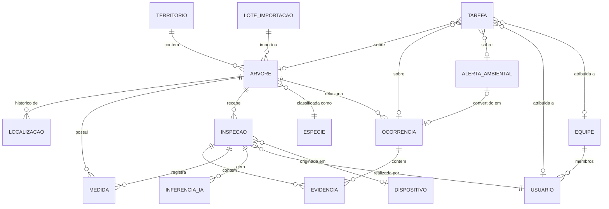

# T-02 — Modelo conceitual de dados

**Status:** Rascunho · Modelo conceitual; o modelo físico será definido após
decisões de [DP-06](../../decisoes/pendentes.md#dp-06) e
[DP-08](../../decisoes/pendentes.md#dp-08).

## 1. Entidades

| Entidade            | Descrição                                                      |
| ------------------- | -------------------------------------------------------------- |
| Território          | Município e subdivisões (bairros, regionais), com geometria, fonte e data. |
| Árvore              | Cadastro individual georreferenciado.                          |
| Localização         | Posição + precisão + origem, versionada por árvore.            |
| Medida              | Valor, unidade, método, origem, data, responsável.             |
| Inspeção            | Visita técnica; estados de processo e de sincronização.        |
| Evidência           | Foto, documento ou arquivo vinculado a inspeção/ocorrência.    |
| Inferência de IA    | Tarefa, modelo, versão, entrada, resultado original, decisão humana. |
| Ocorrência          | Evento que exige avaliação ou ação.                            |
| Alerta ambiental    | Sinal externo: fonte, ID externo, detecção, ingestão, geometria, status. |
| Tarefa              | Atividade atribuída a usuário/equipe, com prazo e estado.      |
| Usuário             | Identidade, papéis, escopo territorial.                        |
| Equipe              | Agrupamento operacional.                                       |
| Espécie             | Catálogo taxonômico com nomes comuns e status.                 |
| Dispositivo         | Origem de registros offline; última sincronização.             |
| Camada geográfica   | Fonte, geometria, data, metadados, licença.                    |
| Lote de importação  | Arquivo, fonte, usuário, data, registros afetados.             |
| Evento de auditoria | Histórico de alterações e decisões.                            |

## 2. Relações

## 3. Requisitos de modelagem

- Identificadores globais gerados no cliente (ex.: UUID) para permitir criação
  offline e retentativas idempotentes.
- Identificadores externos em tabela própria (fonte + valor), múltiplos por
  entidade.
- Exclusão lógica em todas as entidades principais.
- Fusão de árvores registra ID de origem → ID resultante.
- Espécie da árvore referencia a espécie validada; sugestões ficam em
  Inferência de IA.
- Geometrias armazenadas no sistema de referência a definir (DP-06), mantendo o
  SRC original de dados importados.
